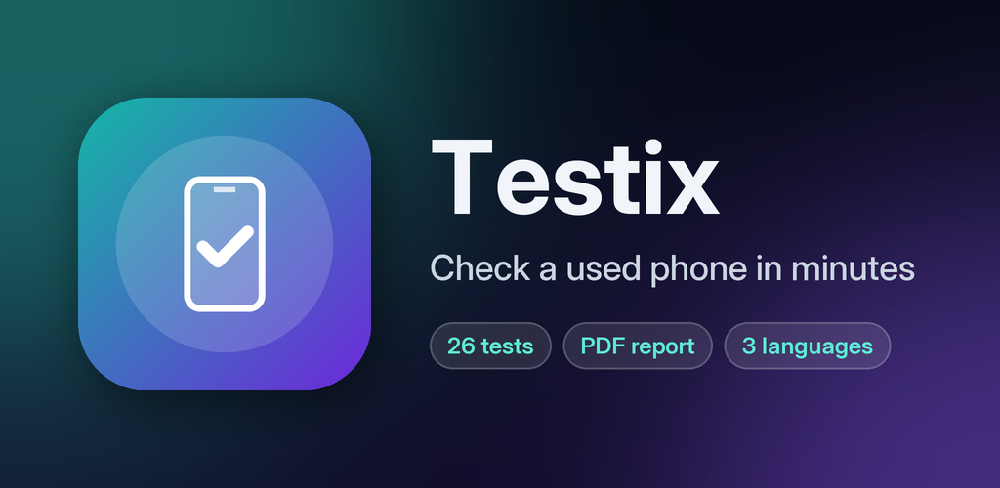
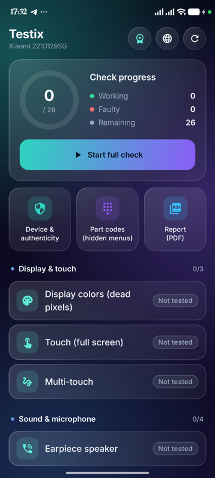
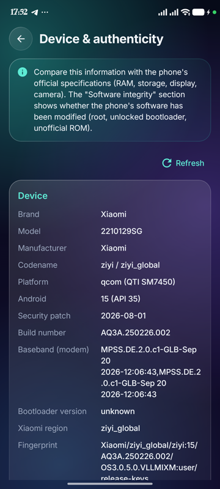
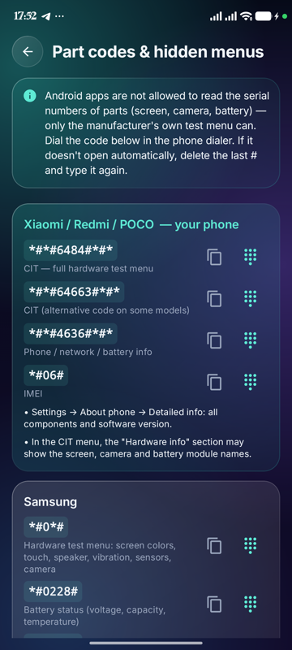
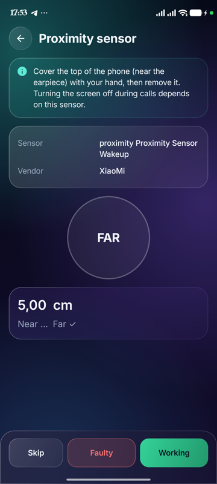
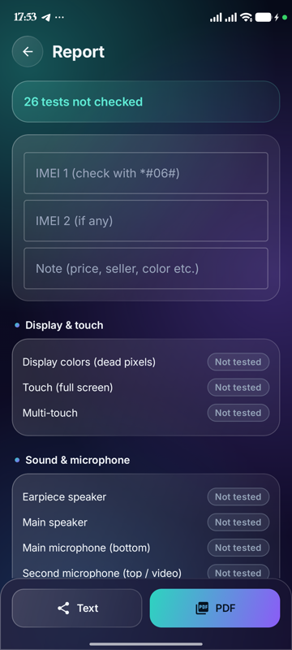
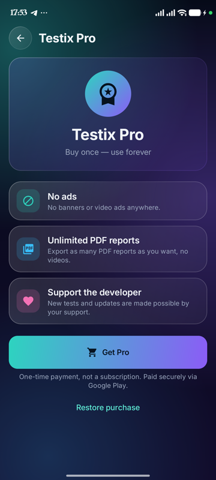

# Testix: Phone Check

    

Buying or selling a used phone? Testix checks every important part in a few minutes and produces a report you can share.
In closed testing on Google Play.

  
  

## What it tests
- **Display** — dead pixels, colour spots, burn-in, full-screen touch grid, multi-touch
- **Sound** — earpiece and speaker with a *beep-count* test (no guessing), both microphones with playback
- **Connectivity** — SIM and network, carrier lock, Wi-Fi, Bluetooth, NFC, GPS satellites
- **Cameras, sensors, buttons, vibration, fingerprint, charging current**
- **Software authenticity** — bootloader lock and Verified Boot via hardware key attestation, root detection, Knox warranty bit, patch age
- **Hidden service menus** — ready-to-dial engineering codes for 9 manufacturers
- **Reports** — text and PDF with results, IMEI and notes

## Product work
- 3 languages (Azerbaijani, English, Russian), store listing and screenshots in all three
- Monetisation: AdMob with EEA consent + one-time **Pro** purchase via Play Billing
- Privacy policy, data-safety form and content rating prepared for Google Play

---

> **Showcase repository.** This repo presents the project — what it does, how it is built and what it looks like.
> The full source code is private. For a walkthrough or a code sample, get in touch.

**Tural Zamanlı** · Data & Automation Developer · [Portfolio](https://dicapso.github.io) · [GitHub](https://github.com/Dicapso)
